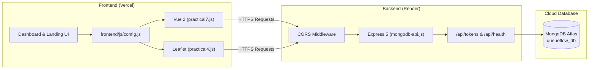

# QueueFlow — Smart Queue Management System

> A modern, full-stack queue management web application built for college Full Stack Development (FSD) practicals, demonstrating reactive interfaces, geolocation mapping, relational SQL, and NoSQL cloud persistence.

[](https://nodejs.org/)
[](https://expressjs.com/)
[](https://www.mongodb.com/)
[](https://v2.vuejs.org/)
[](https://queueflow-frontend-wine.vercel.app/)
[](https://queueflow-2-yumx.onrender.com/)

---

## 🚀 Live Demo

Experience the live application deployed across Vercel and Render:

👉 **[Open QueueFlow Website (Live Frontend)](https://queueflow-frontend-wine.vercel.app/)**

| Component | Platform | URL / Endpoint |
| :--- | :--- | :--- |
| **Live Frontend** | Vercel | [https://queueflow-frontend-wine.vercel.app](https://queueflow-frontend-wine.vercel.app/) |
| **Backend API** | Render | [https://queueflow-2-yumx.onrender.com](https://queueflow-2-yumx.onrender.com/) |
| **API Health Check** | Render | [https://queueflow-2-yumx.onrender.com/api/health](https://queueflow-2-yumx.onrender.com/api/health) *(verification probe)* |
| **Database** | MongoDB Atlas | Cloud M0 Cluster (`queueflow_db.tokens`) |

---

## Project Overview

**QueueFlow** transforms physical counter lines in service centers, banks, and clinics into an automated, contactless queue. Customers book digital tokens, monitor real-time queue positions and estimated wait times, and locate service branches on an interactive map. Counter executives can update status stages (`Waiting` $\rightarrow$ `Serving` $\rightarrow$ `Completed`) or reorder tokens using drag-and-drop.

---

## Key Features

- **Token Booking & Queue Management:** Issues sequential tokens (`A101`, `A102`...) with customer names and target departments.
- **Live Status Dashboard:** Metric cards display active token, position in line, estimated wait time, and live status badges.
- **Token Status Updates & Deletion:** Real-time token stage transitions and removal synced with MongoDB.
- **Drag-and-Drop Queue Reordering:** HTML5 drag-and-drop table allowing executives to resequence tokens with instant backend persistence.
- **HTML5 Geolocation & Leaflet Maps:** Detects coordinates and renders nearby service branches on OpenStreetMap.
- **Browser Local Storage:** Caches active user tokens and provides an offline queue fallback.
- **Vue.js 2 Custom Directives:** Custom directives (`v-uppercase`, `v-format-date`) dynamically format customer names and dates.
- **Bootstrap & Tailwind CSS:** Responsive layouts combining Bootstrap 5 grid/card structures and Tailwind CSS utility styling.
- **MongoDB Atlas Persistence:** Production persistence on MongoDB Atlas with automatic reconnection and indexing.
- **Separate MySQL CRUD Practical:** Independent relational database module demonstrating DDL and DML operations.
- **Separate Role-Based Auth Practical:** Independent native HTTP server demonstrating Admin vs User authorization.

---

## Technologies Used

- **Frontend:** HTML5, CSS3, JavaScript (ES6+), Bootstrap 5, Tailwind CSS, Vue.js 2, Leaflet.js, OpenStreetMap
- **Backend:** Node.js, Express.js 5, Native HTTP (`PR9.js`)
- **Databases:** MongoDB Driver (`^7.7.0`), MongoDB Atlas (Production), MySQL Driver (`^2.18.1`, Practical 8)
- **Deployment & DevOps:** GitHub, Vercel (Frontend SPA), Render (Backend Web Service)

---

## System Architecture & Request Flow



---

## Project Folder Structure

```text
QueueFlow/
├── backend/
│   ├── app.js               # Practical 8: MySQL CRUD & DDL operations
│   ├── mongodb-api.js       # Main Express REST API connected to MongoDB
│   ├── mongodb-crud.js      # Practical 10: Standalone MongoDB CRUD script
│   ├── package.json         # Backend scripts and dependencies
│   ├── package-lock.json    # Dependency lockfile
│   ├── PR9.js               # Practical 9: Native HTTP Role-Based Authentication
│   └── .env.example         # Environment variable template
├── frontend/
│   ├── assets/              # SVG artwork and illustrations
│   ├── css/
│   │   ├── responsive.css   # Mobile media queries
│   │   └── style.css        # Custom styles and animations
│   ├── dashboard.html       # Queue monitoring and token management dashboard
│   ├── index.html           # Public landing page
│   ├── js/
│   │   ├── app.js           # Client greeting and login handling
│   │   ├── config.js        # API base URL configuration (Vercel -> Render)
│   │   ├── practical4.js    # Geolocation, map markers, and token actions
│   │   └── practical7.js    # Vue 2 directives, drag-and-drop, and status sync
│   └── login.html           # Customer login portal
├── .gitignore               # Excludes .env and node_modules
└── README.md                # Project documentation
```

---

## FSD Practicals Implemented

| Practical | Topic | Implementation File(s) | Notes |
| :---: | :--- | :--- | :--- |
| **3** | Responsive Web Design | `frontend/css/responsive.css` | Media queries for mobile, tablet, and desktop |
| **4** | Geolocation, Local Storage and Drag-and-Drop | `frontend/js/practical4.js` | HTML5 Geolocation, Leaflet map markers, token booking |
| **5** | Bootstrap Integration | `frontend/dashboard.html` | Metric cards, utility grids, buttons |
| **6** | Tailwind CSS Integration | `frontend/dashboard.html`, `index.html` | Flexbox utilities, backdrop filters, badges |
| **7** | Vue.js Custom Directives & Queue Management | `frontend/js/practical7.js` | `v-uppercase`, `v-format-date`, reactive queue table |
| **8** | MySQL CRUD Operations | `backend/app.js` | *Standalone practical:* Database, table, insert, update, select, drop |
| **9** | Role-Based Authentication & Access Control | `backend/PR9.js` | *Standalone practical:* Native HTTP server checking Admin vs User roles |
| **10** | MongoDB CRUD Operations | `backend/mongodb-crud.js` | *Standalone practical:* Insert, find, update, and delete on MongoDB |

> *Note:* Practicals 8, 9, and 10 are separate standalone demonstrations for curriculum evaluation and are executed independently via terminal commands.

---

## Database Overview

- **MongoDB Atlas (Production):** Database `queueflow_db`, Collection `tokens`. Stores live customer queue documents with fields: `token`, `customer`, `department`, `status`, `order`, `createdAt`, `joinedAt`. Protected by a unique index on `token`.
- **Local MongoDB (Development):** Defaults to `mongodb://127.0.0.1:27017/queueflow_db` when no cloud URI is provided.
- **MySQL (Practical 8):** Uses local MySQL server (`localhost:3306`) to create `queueflow_db.queue_tokens` and demonstrate relational SQL transactions.

---

## API Endpoints Summary

Base URL: `https://queueflow-2-yumx.onrender.com/api` (or `http://localhost:3000/api` locally)

| Method | Endpoint | Purpose |
| :--- | :--- | :--- |
| `GET` | `/api/health` | Health check & database connection probe |
| `GET` | `/api/tokens` | Retrieve all active tokens sorted by queue order |
| `POST` | `/api/tokens` | Issue and persist a new queue token (Conflict 409 on duplicate) |
| `GET` | `/api/tokens/:token` | Fetch details for a specific token identifier |
| `PUT` | `/api/tokens/:token` | Update customer, department, status, or position |
| `PUT` | `/api/tokens/reorder` | Batch update queue sequence after drag-and-drop |
| `DELETE` | `/api/tokens/:token` | Delete a served or canceled token from the database |

---

## Prerequisites

- **Node.js:** v18.0.0 or higher
- **npm:** v9.0.0 or higher
- **MongoDB:** MongoDB Atlas account (or local MongoDB Community Server v6+)
- **MySQL:** MySQL Server v8+ (only needed for running Practical 8)

---

## Installation & Local Setup

1. **Clone the repository:**
   ```bash
   git clone https://github.com/kotechameet485-droid/queueflow.git
   cd queueflow
   ```

2. **Install backend dependencies:**
   ```bash
   cd backend
   npm install
   ```

---

## Environment Variable Configuration

Create a `.env` file inside the `backend/` directory based on `.env.example`:

```bash
# Inside backend/ directory
cp .env.example .env
```

Configure your environment variables:

```env
PORT=3000
NODE_ENV=development

# Cloud Atlas URI (in production) or leave blank for local mongodb://127.0.0.1:27017
MONGODB_URI=mongodb+srv://<db_user>:<db_password>@<cluster>.mongodb.net/?retryWrites=true&w=majority

DB_NAME=queueflow_db
COLLECTION_NAME=tokens

# Set to exact Vercel frontend URL WITHOUT trailing slash
CORS_ORIGIN=https://queueflow-frontend-wine.vercel.app
```

> **Security Rules:**
> - Never commit `.env` or real database credentials to Git.
> - `CORS_ORIGIN` must not contain a trailing slash (e.g. `https://example.vercel.app` not `https://example.vercel.app/`).
> - On Render, configure `MONGODB_URI` and `CORS_ORIGIN` under the service **Environment** dashboard.

---

## Running the Project

### 1. Main QueueFlow Web Server (Express + MongoDB)
```bash
cd backend
npm start
# Server runs on http://localhost:3000
# Dashboard accessible at http://localhost:3000/dashboard.html
```

### 2. Standalone Curriculum Practicals
```bash
# Practical 8: MySQL CRUD demonstration (requires local MySQL)
npm run mysql

# Practical 9: Role-Based Authentication demonstration (runs on port 3001)
npm run pr9

# Practical 10: Standalone MongoDB CRUD operations
npm run crud
```

---

## Deployment Architecture

QueueFlow uses a decoupled multi-cloud architecture:

- **Frontend Hosting (Vercel):** Hosts static assets (`dashboard.html`, `index.html`, `login.html`, styles, and scripts). `frontend/js/config.js` directs API requests to the Render backend URL.
- **Backend API (Render):** Hosts the Express 5 Node.js web service (`backend/mongodb-api.js`).
  - *Root Directory:* `backend`
  - *Build Command:* `npm install`
  - *Start Command:* `npm run api`
- **Cloud Database (MongoDB Atlas):** M0 free cluster hosting `queueflow_db`. Render dynamic IPs are whitelisted via Network Access (`0.0.0.0/0`).
- **Live Health Verification:** [https://queueflow-2-yumx.onrender.com/api/health](https://queueflow-2-yumx.onrender.com/api/health) probes database connectivity and token counts.

---

## Security Notes

- **Credential Sanitization:** Server startup and error logs automatically mask connection URIs (`//<credentials>@...`) to prevent credential leakage.
- **Strict Production Guards:** In production (`NODE_ENV=production`), `MONGODB_URI` is strictly required and refuses silent fallback to localhost.
- **TLS Verification:** Official MongoDB Node driver strictly enforces TLS validation without insecure bypasses.
- **CORS Protection:** Rejects unauthorized cross-origin requests with HTTP 403 in production.
- **Git Hygiene:** `.gitignore` actively ignores `.env`, `.env.local`, and `node_modules/`.

---

## Author Information

- **Project:** QueueFlow — Smart Queue Management System
- **Context:** Full Stack Development (FSD) Practical Laboratory Project
- **Repository:** [https://github.com/kotechameet485-droid/queueflow](https://github.com/kotechameet485-droid/queueflow)
